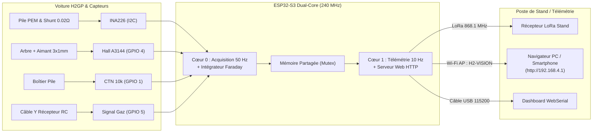

# 🏎️ H2-Vision — Système de Télémétrie Embarqué (H2GP 2026)

[](https://platformio.org/)
[](https://www.freertos.org/)
[](https://www.horizoneducational.com/)
[](LICENSE)

Système de télémétrie embarquée haute précision, temps réel et **100 % non-intrusif** développé par l'équipe **ECE Paris** pour la compétition **Horizon Hydrogen Grand Prix (H2GP)**.

Le système monitore en direct la pile à combustible à hydrogène, la consommation par la **loi de Faraday**, la vitesse au sol et la cinématique du châssis, et transmet les données au stand via **LoRa 868 MHz** et un point d'accès **Wi-Fi autonome avec tableau de bord Web intégré**.

---

## 📑 Sommaire
1. [Architecture Technique & Schéma](#-architecture-technique)
2. [Brochage Officiel (ESP32-S3)](#-brochage-officiel-esp32-s3)
3. [Structure du Répertoire](#-structure-du-dépôt)
4. [Guide de Démarrage Rapide](#-guide-de-démarrage-rapide)
5. [Le Tableau de Bord Web (Stand & Pit-Wall)](#-tableau-de-bord-web-de-stand)
6. [Kit de Transmission & Reprise de Projet](#-kit-de-transmission-reprise-du-projet)

---

## 🛠️ Architecture Technique

Le système repose sur une séparation matérielle et logicielle via l'ordonnanceur **FreeRTOS** exploitant les 2 cœurs du microcontrôleur **ESP32-S3** (240 MHz) :

- **Cœur 0 — Tâche d'Acquisition (50 Hz / 20 ms) :**
  - **Puissance & Faraday (TI INA226 en I2C Fast-Mode) :** Mesure de la tension pile (0–15V) et du courant moteur (0–15A) à travers un shunt de $0.02\,\Omega$. Intégration en temps réel de la masse d'$H_2$ consommée selon la formule de Faraday :
    $$\Delta n_{H_2} = \frac{I \cdot \Delta t}{2 \cdot F \cdot \eta_{\text{Faraday}}}$$
  - **Vitesse & RPM (Capteur Hall A3144 par interruption ISR) :** Détection d'un aimant néodyme $3\times 1\,\text{mm}$ sur l'arbre de transmission avec filtre anti-rebond $1000\,\mu\text{s}$.
  - **Gâchette Pilote (Câble Y Servo par interruption ISR) :** Décodage non-bloquant de la largeur d'impulsion PWM ($1000\text{--}2000\,\mu\text{s} \rightarrow 0\text{--}100\,\%$).
  - **Température Pile (Thermistance CTN 10k B3950 sur ADC1) :** Calcul de température par l'équation de Steinhart-Hart avec seuil d'alarme de sécurité thermique à $55\,^\circ\text{C}$.

- **Cœur 1 — Tâche de Télémétrie & Réseau (10 Hz / 100 ms) :**
  - Encapsulation binaire compacte (paquet de **20 octets** validé par contrôle mathématique **CRC16-CCITT**).
  - Émission sans fil longue portée par le transceiver **Semtech SX1262 LoRa 868 MHz**.
  - Serveur Web embarqué hébergé sur le point d'accès Wi-Fi autonome `H2-VISION`.
  - Flux série CSV sur port USB pour banc d'essai et télémétrie filaire.



---

## 📌 Brochage Officiel (ESP32-S3)

Conforme au schéma électronique KiCad 10 et au fichier de configuration [`H2VISION/include/config.h`](H2VISION/include/config.h) :

| Capteur / Périphérique | Ligne / Signal | Broche ESP32-S3 | Remarques de câblage |
| :--- | :--- | :---: | :--- |
| **Capteur Hall A3144 (KY-003)** | Sortie Signal `S` | **`GPIO 4`** | Interruption matérielle (front descendant) |
| **Câble Y Servo (Gâchette)** | Impulsion PWM | **`GPIO 5`** | Signal blanc/jaune de la radiocommande |
| **Capteur Électrique INA226** | Données I2C `SDA` | **`GPIO 8`** | Bus 400 kHz Fast Mode |
| **Capteur Électrique INA226** | Horloge I2C `SCL` | **`GPIO 9`** | Bus 400 kHz Fast Mode |
| **Thermistance CTN 10k** | Point milieu ADC | **`GPIO 1`** | Pont diviseur avec résistance 10k vers GND |
| **Transceiver LoRa SX1262** | SPI Chip Select `NSS`| **`GPIO 10`** | Module Waveshare Core1262-868M |
| **Transceiver LoRa SX1262** | SPI `MOSI` | **`GPIO 11`** | Ligne données sortantes SPI |
| **Transceiver LoRa SX1262** | SPI `SCK` | **`GPIO 12`** | Horloge SPI |
| **Transceiver LoRa SX1262** | SPI `MISO` | **`GPIO 13`** | Ligne données entrantes SPI |
| **Transceiver LoRa SX1262** | `BUSY` / `DIO1` / `RST`| **`14 / 21 / 47`** | Contrôle matériel d'état et reset |

---

## 📁 Structure du Dépôt

```text
├── H2VISION/                 # Projet PlatformIO (Firmware microcontrôleur)
│   ├── include/
│   │   ├── config.h          # Définition des broches et constantes physiques
│   │   ├── telemetry_packet.h# Structure binaire 20 octets et CRC16
│   │   ├── sx1262_driver.h   # Pilote SPI natif non-bloquant pour SX1262
│   │   └── web_dashboard.h   # Tableau de bord HTML stocké en mémoire Flash
│   ├── src/
│   │   └── main.cpp          # Boucle temps réel Dual-Core FreeRTOS
│   └── platformio.ini        # Configuration de compilation pour ESP32-S3
├── dashboard/
│   └── index.html            # Tableau de bord complet pour navigateur PC
├── docs/                     # Documents de conception et spécifications
│   ├── architecture_technique_h2_vision.md
│   ├── architecture_technique_2pages.html
│   └── BOM_Composants_H2_Vision.csv
└── README.md                 # Le présent guide technique de transmission
```

---

## 🚀 Guide de Démarrage Rapide

### Prérequis logiciels
1. Installer **[VS Code](https://code.visualstudio.com/)**.
2. Installer l'extension **[PlatformIO IDE](https://platformio.org/)** dans VS Code.
3. Cloner le dépôt :
   ```bash
   git clone https://github.com/<votre-equipe>/H2-Vision.git
   cd H2-Vision
   ```

### Compilation et Téléversement
1. Dans VS Code, ouvrir le dossier `H2VISION`.
2. Connecter l'ESP32-S3 via un câble USB-C (de préférence sur le port marqué **`UART`** ou `COM`).
3. Compiler le projet :
   ```bash
   pio run
   ```
4. Téléverser sur la carte :
   ```bash
   pio run -t upload
   ```
5. Ouvrir le moniteur série (vitesse : `115200` bauds) :
   ```bash
   pio device monitor
   ```

---

## 📊 Tableau de Bord Web de Stand

Le système inclut une interface de poste de stand ultra-complète développée en HTML5/Canvas/CSS (sans dépendance externe lourde) :

1. **Connexion sans fil directe :**
   - Connecter son PC, smartphone ou tablette au réseau Wi-Fi : **`H2-VISION`** (mot de passe : **`h2gp2026`**).
   - Ouvrir un navigateur et aller à l'adresse : **`http://192.168.4.1`**.
2. **Connexion par câble USB (Banc d'essai) :**
   - Ouvrir le fichier [`dashboard/index.html`](dashboard/index.html) dans Google Chrome ou Microsoft Edge.
   - Cliquer sur le bouton **`🔌 USB Série`** et sélectionner le port COM de l'ESP32-S3 à 115200 bauds.
3. **Fonctionnalités intégrées :**
   - Jauges de vitesse réelle et régime de rotation arbre.
   - Puissance instantanée en Watts et suivi de tension/courant.
   - Jauge de niveau de réservoir Hydrostik restant (calcul Faraday).
   - Enregistreur de tours (touche <kbd>L</kbd>) avec comparaison automatique du meilleur rendement ($m/\text{Wh}$).

---

## 🤝 Kit de Transmission (Reprise du Projet)

Ce chapitre répond directement aux exigences du jury pour assurer la continuité du projet par un tiers ou une future équipe :

### 1. Prérequis indispensables pour reprendre le projet
- Aucun compilateur externe payant n'est requis : l'environnement fonctionne sous PlatformIO / GCC Xtensa gratuit et open-source.
- Le firmware a été conçu **sans dépendance de bibliothèque externe dans `lib_deps`** : les pilotes I2C et SPI du SX1262 et de l'INA226 sont écrits en natif pour garantir une compilation 100 % hors-ligne et reproductible à l'infini.

### 2. Limites connues et points de vigilance actuels
- **Gestion du shunt INA226 :** Le shunt actuel est calibré pour $0.02\,\Omega$ ($20\,\text{m}\Omega$). Si le shunt physique est modifié, ajuster la valeur `INA226_R_SHUNT_OHM` dans `config.h`.
- **Pont diviseur CTN :** Le pont diviseur de la thermistance doit impérativement être alimenté en **3.3V** et jamais en 5V sous peine d'endommager l'entrée analogique ADC de l'ESP32-S3.
- **Portée Wi-Fi vs LoRa :** Le Wi-Fi de l'ESP32-S3 offre une portée d'environ 50 à 70 mètres en champ libre. Pour la couverture complète du circuit de 4 heures, la liaison longue distance LoRa 868 MHz prend le relais vers le récepteur de stand.

### 3. Le message clé au repreneur
> *"Si vous devez reprendre ce projet aujourd'hui, sachez que l'architecture matérielle et les algorithmes de calcul physique (loi de Faraday, Steinhart-Hart, odométrie) sont 100 % validés et découplés sur le Cœur 0. Votre mission principale consistera uniquement à soigner l'intégration mécanique des capteurs sur le châssis réel de la voiture (fixation de l'aimant néodyme sur l'arbre central et application de la pâte thermique/ruban Kapton sur la pile PEM)."*

---

*Projet réalisé dans le cadre de la compétition Horizon Hydrogen Grand Prix 2026 — Équipe ECE Paris.*
