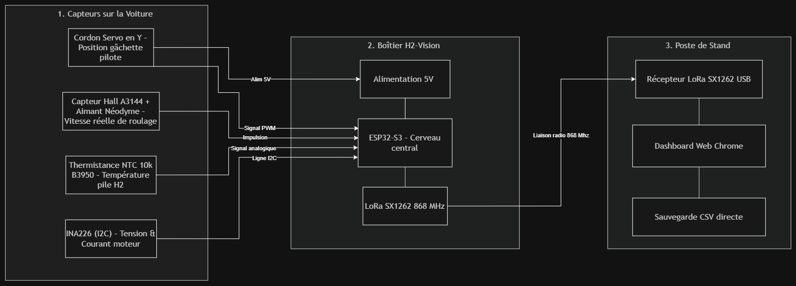

# Architecture Technique Globale — Système H2-Vision
## Télémétrie Embarquée « Clé en Main » pour Horizon Hydrogen Grand Prix (H2GP Stock)

**Projet :** H2-Vision — Télémétrie Haute Précision Non Intrusive  
**Partenariat :** ECE Paris / Horizon Educational  
**Châssis cible :** 1/10 4WD Piste (Kit officiel H2GP Stock : Variateur Vega Power, Moteur 540, Pile H-30)  
**Contraintes réglementaires :** Masse totale $\le 35\,\text{g}$, Zéro fil coupé, Zéro soudure, Retrait $< 1\,\text{min}$

---

## 1. Schéma d’Architecture Technique & Frontières Systèmes

Le système **H2-Vision** est structuré en **trois sous-systèmes interconnectés** délimitant clairement les frontières matérielles et logicielles :



```mermaid
flowchart LR
    subgraph S1 ["1. Véhicule H2GP Stock (Capteurs)"]
        direction TB
        C4["🎮 Câble Servo en Y<br/>Position gâchette pilote"]
        C2["🧲 Aimant + Hall A3144<br/>Vitesse réelle de roulage"]
        C3["🌡️ Sonde NTC 10k<br/>Température pile H2"]
        C1["⚡ Pont Tamiya + INA226<br/>Tension & Courant moteur"]
    end

    subgraph S2 ["2. Boîtier H2-Vision (max 35g)"]
        direction TB
        B1["🔋 Alimentation 5V BEC<br/>Tampon 470 µF anti-brownout"]
        B2["🧠 ESP32-S3 (Dual-Core)<br/>Acquisition 50 Hz & Faraday"]
        B3["📡 Émetteur LoRa 868 MHz<br/>Semtech SX1262 (SPI)"]
        B1 --> B2
        B2 --> B3
    end

    subgraph S3 ["3. Poste de Stand (Pit-Wall)"]
        direction TB
        P1["📡 Récepteur LoRa USB<br/>Pont Série virtuel"]
        P2["💻 Dashboard Web Chrome<br/>WebSerial API temps réel"]
        P3["📁 Sauvegarde CSV directe<br/>Stratégie d'après-course"]
        P1 --> P2
        P2 --> P3
    end

    C4 -->|Alim 5V BEC| B1
    C4 -->|Signal PWM| B2
    C2 -->|Impulsion GPIO| B2
    C3 -->|Tension analogique ADC| B2
    C1 -->|Ligne I2C 400 kHz| B2
    B3 -.->|Liaison radio 868 MHz (500m)| P1

    classDef car fill:#e1f5fe,stroke:#0288d1,stroke-width:1.5px;
    classDef box fill:#e8f5e9,stroke:#388e3c,stroke-width:1.5px;
    classDef pit fill:#fff3e0,stroke:#f57c00,stroke-width:1.5px;
    class C1,C2,C3,C4 car;
    class B1,B2,B3 box;
    class P1,P2,P3 pit;
```

### Description des Flux et Protocoles de Communication
1. **Liaison Puissance & Alimentation (Voiture $\rightarrow$ Boîtier) :** Le $5\,\text{V}$ régulé provient du BEC de l'ESC via la dérivation du cordon servo en Y (CH2). Un condensateur de $470\,\mu\text{F}$ immunise l'ESP32 contre les micro-coupures induites par le servo de direction.
2. **Liaisons Capteurs Embarqués (Voiture $\rightarrow$ ESP32-S3) :**
   - **INA226 :** Bus numérique I2C bidirectionnel ($400\,\text{kHz}$) pour la mesure différentielle du shunt ($0{,}02\,\Omega$) et de la tension bus.
   - **Capteur Hall A3144 :** Signal tout-ou-rien sur interruption GPIO matérielle (comptage de fronts descendants et capture $\mu\text{s}$).
   - **Thermistance NTC 10k :** Signal analogique ratiométrique lu par l'ADC 12 bits de l'ESP32-S3 (loi de Steinhart-Hart).
   - **Gâchette Radio :** Signal PWM ($50\,\text{Hz}$, rapport cyclique $1000-2000\,\mu\text{s}$) intercepté par capture de largeur d'impulsion GPIO.
3. **Liaison Télécommunication (Boîtier $\rightarrow$ Stand) :** Trame binaire compacte de 20 octets transmise par LoRa SX1262 en modulation 868 MHz ($+14\,\text{dBm}$, SF7, BW 500 kHz, Time-on-Air $= 11{,}8\,\text{ms}$, Duty-Cycle $< 1{,}2\,\%$).
4. **Liaison Stand (Passerelle $\rightarrow$ Dashboard) :** Réception par le pont USB LoRa, décodage natif sous Google Chrome via l'API **WebSerial** ($115\,200\,\text{bauds}$) sans aucun driver, affichage fluide à 60 FPS et écriture synchrone en flux CSV continu.

---

## 2. Matrice de Traçabilité N-N : Spécifications Fonctionnelles (SF) $\leftrightarrow$ Composants

Chaque composant technique répond à un ou plusieurs SF, et chaque SF s'appuie sur une chaîne de composants dédiés :

| Spécification Fonctionnelle (Besoin Métier H2GP) | Composants Techniques Associés (Chaîne N-N) | Rôle dans la réalisation du SF |
| :--- | :--- | :--- |
| **SF1 : Mesure électrique chaîne de traction** ($U, I, P, E_{Wh}$) | Pont Tamiya gigogne, Shunt $0{,}02\,\Omega$, Puce TI INA226, Bus I2C, ESP32-S3 (Core 0), Dashboard Web | Prélèvement série non intrusif, numérisation 16 bits, calcul de la puissance instantanée et de l'énergie consommée. |
| **SF2 : Jauge d'hydrogène restante** (Estimation $SoC_{H_2}$) | INA226 (Mesure de courant pile), ESP32-S3 (Algorithme de Faraday), Dashboard Stand | Intégration coulombmétrique continue : $\Delta n_{H_2} = \frac{\int I \, dt}{2F}$. Calcul du % restant et prédiction des tours avant ravitaillement. |
| **SF3 : Cinématique & Vitesse de roulage** ($v_{km/h}$, RPM, distance) | Aimant Néodyme N48 (arbre), Capteur Hall A3144, ESP32-S3 (Timer $\mu\text{s}$), Dashboard Web | Détection magnétique sans contact. Conversion période d'impulsion $\rightarrow$ régime arbre de transmission et vitesse linéaire du véhicule. |
| **SF4 : Surveillance thermique de la membrane** ($T_{\text{pile}}$) | Sonde NTC 10k B3950, Ruban Kapton thermique, ADC 12 bits ESP32-S3, Dashboard Stand | Contact thermique sous gaine du stack H-30. Alerte visuelle ($50\,^\circ\text{C}$) et sonore ($55\,^\circ\text{C}$) au stand pour prévenir la déshydratation du Nafion. |
| **SF5 : Profilage de l'effort pilote** (% gâchette accélérateur) | Cordon Servo en Y (Voie 2), ESP32-S3 (Capture interruption PWM), Dashboard Stand | Lecture passive de la consigne d'accélération ($0-100\%$) pour corréler la conduite avec les pics de consommation électrique. |
| **SF6 : Transmission télémétrique longue portée sécurisée** | ESP32-S3 (Core 1), Émetteur SX1262 868 MHz, Récepteur LoRa USB, Antenne quart d'onde | Transmission radio $> 500\,\text{m}$ insensible aux 30 émetteurs RC 2.4 GHz concurrents. Contrôle d'intégrité par CRC16. |
| **SF7 : Restitution visuelle et archivage stand sans installation** | Récepteur USB, Navigateur Web Chrome (WebSerial API), Dashboard HTML5/Canvas, Log CSV | Affichage instantané en bord de piste sur PC portable étudiant sans configuration logicielle préalable, enregistrement pérenne pour analyse post-course. |
| **SF8 : Respect strict du règlement Stock** (Masse $\le 35\,\text{g}$, Zéro soudure) | Boîtier PETG allégé, Connecteurs débrochables Tamiya/JR, Condensateur 470 µF anti-brownout | Zéro coupure de fil sur le véhicule officiel, démontage complet en moins de 45 secondes, alimentation 100% autonome via le BEC de bord. |

---

## 3. Justification Complète des Choix Technologiques

| Composant | Technologie choisie | Alternatives / État de l'art | Pourquoi ce choix ? (Justification technique & compromis) |
| :--- | :--- | :--- | :--- |
| **Calculateur Central** | **ESP32-S3 (Bicoeur Xtensa 240 MHz)** | Arduino Nano 33 BLE, STM32F4, Raspberry Pi Zero 2W | Architecture bicoeur permettant d'isoler l'acquisition 50 Hz/Faraday (Core 0) de la télécommunication LoRa (Core 1). Poids plume ($< 5\,\text{g}$) et consommation maîtrisée ($< 0{,}5\,\text{W}$) face à une Pi Zero ($25\,\text{g}, 2{,}5\,\text{W}$) inadaptée au kit Stock. |
| **Mesure Électrique** | **TI INA226 (Shunt externe $0{,}02\,\Omega$, I2C)** | Capteur Hall ACS712, INA219, Shunt passif nu | Résolution 16 bits très supérieure à l'INA219 (12 bits), dérive thermique quasi nulle ($10\,\text{ppm}/^\circ\text{C}$), chute de tension négligeable ($< 0{,}3\,\text{V}$ à $15\,\text{A}$) et immunité totale au bruit ambiant par rapport à l'ACS712. |
| **Capteur Vitesse** | **Effet Hall A3144 + Aimant Néodyme N48** | Encodeur optique à disque, Centrale inertielle IMU, GPS 10 Hz | Totalement insensible aux projections de gomme et poussières (contrairement à l'optique). Zéro dérive d'intégration mathématique (contrairement à l'IMU). Fonctionnement garanti sur piste couverte (indoor) où le GPS est inopérant. |
| **Liaison Sans Fil** | **LoRa Semtech SX1262 (Bande ISM 868 MHz)** | Wi-Fi 2.4 GHz ESP, nRF24L01+ (2.4 GHz), Bluetooth BLE | Échappe intégralement à la saturation du spectre 2.4 GHz (occupé par les 30 radiocommandes RC FHSS). Portée certifiée $> 500\,\text{m}$ avec un budget de liaison de $+135\,\text{dB}$, garantissant zéro décrochage en course. |
| **Capteur Température** | **Thermistance CTN 10k B3950 (Perle fine)** | Sonde I2C TC74 / TMP117, Capteur PT100, Thermocouple K | Diamètre inférieur à $1\,\text{mm}$ autorisant une insertion directe sous l'habillage du stack H-30 sans modifier le couple de serrage mécanique de la pile. Excellente réactivité thermique ($< 1\,\text{s}$). |
| **Interface Stand** | **Dashboard Web HTML5 + API WebSerial** | Application lourde PyQt / C++, Application Electron, InfluxDB/Grafana | Portabilité universelle immédiate (Windows, Linux, Mac) sans installer aucun logiciel ni runtime Python. Connexion série directe au navigateur en 1 clic. Temps de cycle d'affichage $< 16\,\text{ms}$. |

---

## 4. Les 3 Décisions d'Ingénierie Clés — Effet « WOW »

### Choix 1 — Microcontrôleur ESP32-S3 Dual-Core (FreeRTOS) plutôt qu'un microcontrôleur monocœur ou une Raspberry Pi
* **Critère principal :** Déterminisme temporel absolu de la chaîne de mesure couplé à une contrainte de masse extrême ($\le 35\,\text{g}$).
* **Impact :** Le Core 0 traite l'acquisition 50 Hz, l'ISR microseconde de l'arbre moteur et l'intégration de Faraday avec un jitter strictement inférieur à $2\,\mu\text{s}$, pendant que le Core 1 gère la pile radio LoRa SPI. La carte complète pèse moins de $5\,\text{g}$ et consomme $90\,\text{mA}$, réduisant la masse globale de $80\%$ par rapport à un nano-ordinateur Linux.
* **Contrepartie :** Développement bas-niveau en C++/FreeRTOS exigeant (synchronisation mémoire par files bloquantes `xQueueSendFromISR` et sections critiques).

### Choix 2 — Télécommunication LoRa SX1262 868 MHz plutôt que les liaisons conventionnelles 2.4 GHz (Wi-Fi / nRF)
* **Critère principal :** Robustesse et continuité de service radioélectrique en environnement électromagnétique ultra-dense.
* **Impact :** Zéro perte de paquets sur une portée de 500 mètres. Le signal opère sur une bande sub-gigahertz totalement étanche aux 30 radiocommandes RC 2.4 GHz des concurrents et aux smartphones du public, avec une sensibilité de $-129\,\text{dBm}$.
* **Contrepartie :** Débit utile contraint, imposant la conception d'un protocole binaire custom compacté sur 20 octets (Time-on-Air $11{,}8\,\text{ms}$, Duty-Cycle $1{,}2\,\%$).

### Choix 3 — Jauge Hydrogène Coulombmétrique par Loi de Faraday (INA226) plutôt qu'une sonde fluidique de pression/débit
* **Critère principal :** Règle de non-intrusivité H2GP Stock (interdiction formelle de modifier le circuit gazeux) et physique des hydrures métalliques.
* **Impact :** Mesure $100\%$ indirecte et non intrusive de la consommation d'hydrogène par intégration coulombmétrique continue ($\dot{n}_{H_2} = I_{\text{stack}} / 2F$). Résout le problème fondamental de la jauge sur cartouche Hydrostik, dont la pression reste bloquée sur un plateau isotherme à 2 bar jusqu'à épuisement quasi-total, rendant les manomètres classiques aveugles.
* **Contrepartie :** Dépendance à la calibration du rendement faradique de la cellule ($\eta_F \approx 0{,}98$) et nécessité d'un reset synchrone au changement de bouteille.

---

## 5. Analyse des Risques Techniques & Stratégies de Vérification

| Risque Technique Identifié | Prob. | Impact | Protocole de Vérification & Solution de Mitigation |
| :--- | :---: | :---: | :--- |
| **R1. Brownout / Micro-coupure 5V** provoquée par l'appel de courant crête ($> 1{,}5\,\text{A}$) du servo de direction. | **M** | **F** | **Vérification :** Monitoring du rail $5\,\text{V}$ à l'oscilloscope à mémoire lors de braquages en butée rapide sous charge mécanique.<br/>**Mitigation :** Implantation d'un condensateur de découplage de $470\,\mu\text{F}$ Low-ESR directement sur la broche VIN de l'ESP32. |
| **R2. Dérive de l'estimation Faraday** liée aux cycles d'ouverture de l'électrovanne de purge de la pile à combustible H-30. | **M** | **M** | **Vérification :** Banc d'essai stationnaire de décharge : pesée de la cartouche Hydrostik avant et après essai à la balance analytique ($0{,}01\,\text{g}$).<br/>**Mitigation :** Ajustement logiciel du coefficient faradique $\eta_F$ intégrant les pertes périodiques de purge (intervalle 10 s). |
| **R3. Masquage RF et atténuation du signal radio** causé par les châssis carbone/aluminium et clôtures de circuit. | **F** | **M** | **Vérification :** Cartographie terrain du RSSI et du SNR sur 360° autour de la piste avec enregistrement des taux de paquets perdus (PER).<br/>**Mitigation :** Antenne fouet $\lambda/4$ accordée à 868 MHz surélevée de 3 cm au-dessus du châssis et configuration SF7/BW 500 kHz. |
| **R4. Rebond mécanique ou saut d'impulsion** sur le capteur à effet Hall à régime moteur maximal ($> 8\,000\,\text{tr/min}$). | **F** | **F** | **Vérification :** Banc d'étalonnage avec banc tachymétrique laser optique de référence comparant la fréquence d'interruption mesurée.<br/>**Mitigation :** Filtre matériel RC ($100\,\Omega / 10\,\text{nF}$) + blanking time logiciel de $500\,\mu\text{s}$ dans l'ISR pour rejeter les déclenchements parasites. |

---

## 6. Synthèse des Connaissances, Suppositions et Essais Restants

* **Ce qui est validé et certain :** La conformité réglementaire Stock (zéro coupure, démontage par connecteurs industriels Tamiya/JR) ; le fonctionnement I2C de l'INA226 ; le décodage WebSerial natif sans dépendance externe.
* **Ce qui est supposé et à dimensionner :** La capacité du BEC de l'ESC Vega Power à délivrer $120\,\text{mA}$ continus sans échauffement excessif sur 4 heures de course ; la linéarité du coefficient de purge hydrogène sur cycle transitoire.
* **Plan d'essais de qualification restant :**
  1. *Test d'endurance thermique :* 60 minutes de roulage sous carrosserie fermée avec mesure de la température interne du boîtier PETG.
  2. *Bilan de masse final métrologique :* Pesée de l'ensemble boîtier + câblage sur balance de précision certifiée ($\le 35{,}0\,\text{g}$).
